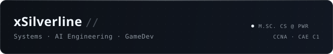
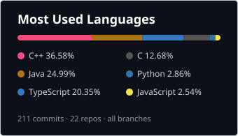

  

Computer Science M.Sc. student focused on turning unfamiliar tech into working systems  
  -> from adaptive AI agents and LLM pipelines to web apps and network infrastructure. 

**Currently into:**
- 💻 **Coding:** Adaptive AI Game Manager (`Python` + `PyTorch` + `UE5`) & 3D PC Airflow CFD Simulator
- 🎮 **Gaming:** Black Desert Online & Satisfactory & Space Engineers 2
- 🔧 **Tinkering:** PC hardware, GPU UV, Airflow & system optimization
- 🎧 **Listening:** Symphonic metal, Deep focus music & dark orchestral game OSTs
- 🎶 **Creating:** Music on YT, My own game
- 🏔️ **Offline:** Mountain hiking & water sports

---

### Tech Stack

###### Languages

###### AI & Backend

###### Frontend

###### GameDev & 3D

###### Systems, Networks & Tools

---

### Telemetry

  

